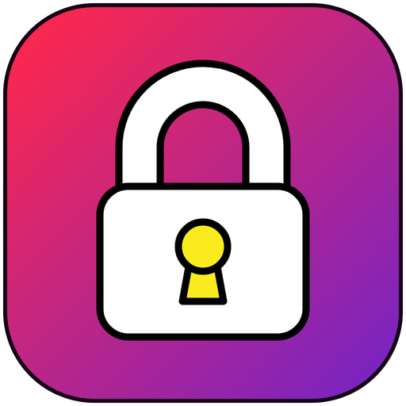
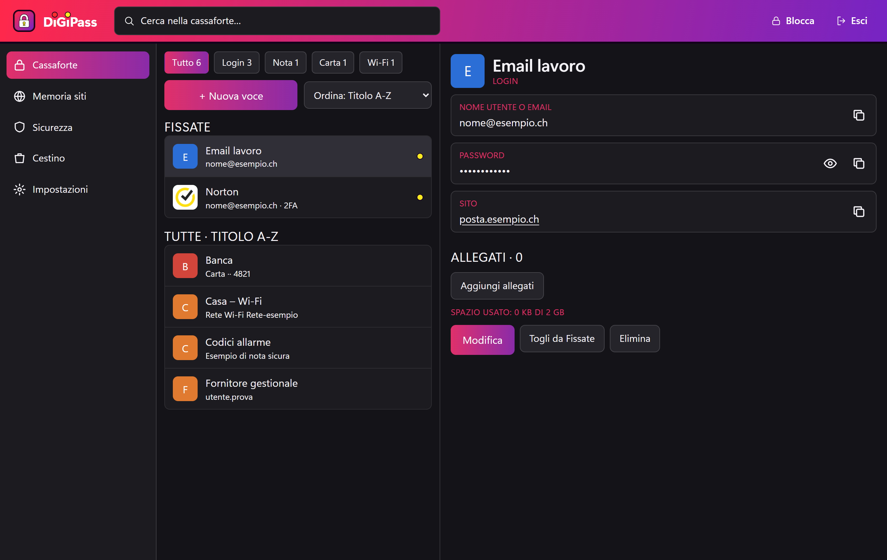
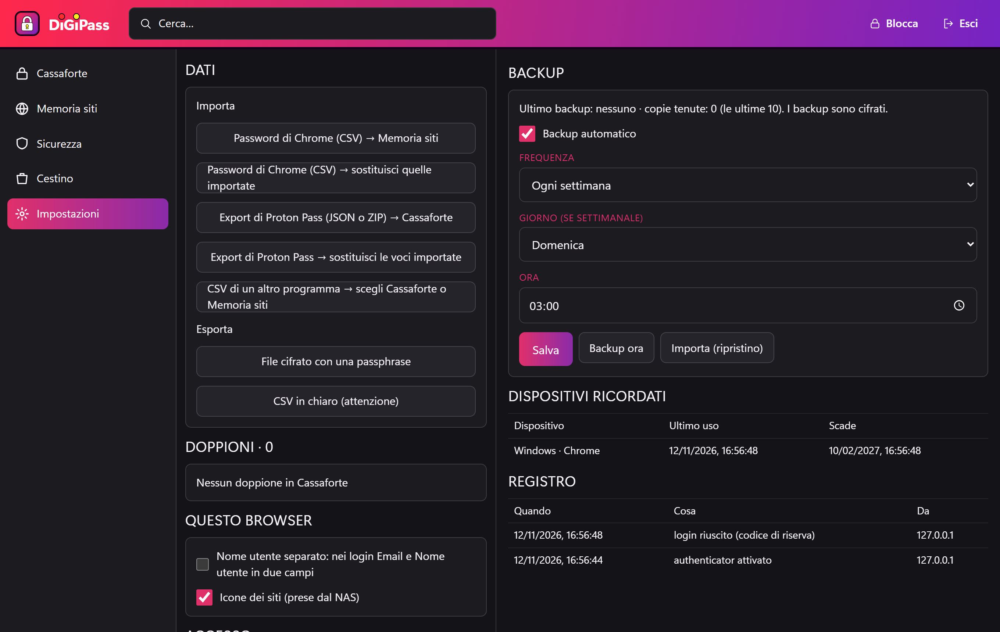
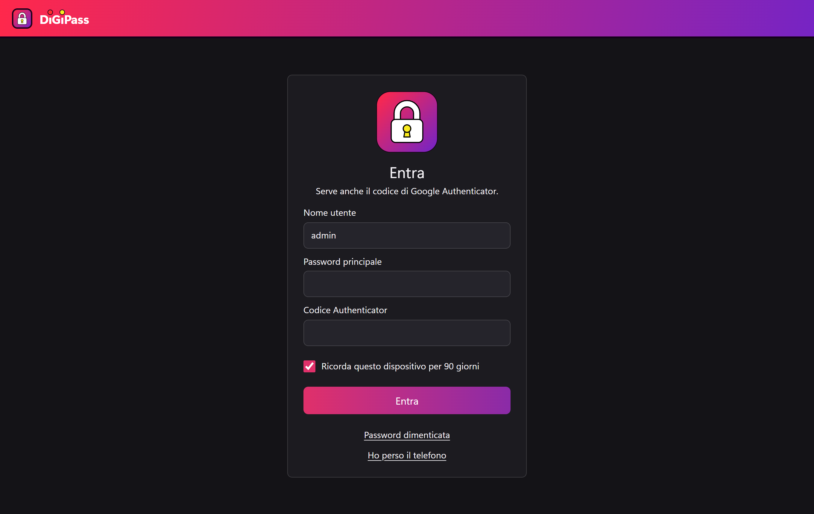

<p align="center">
  
</p>

<p align="center">
  
</p>

# DiGiPass

## 🔐 Le tue password sul telefono, nel browser e sul tuo server: cifrate prima di uscire dal telefono

### ⬇️ [Scarica l'APK per Android](https://github.com/DiGi-Apps-Dev/DiGiPass/releases/latest)

Un gestore di password per Android, con una webapp e un'estensione per Chrome. Funziona anche da solo sul telefono; se vuoi sincronizzare, il server lo installi tu con Docker e vede solo dati cifrati. DiGiPass fa parte di **DiGi Apps**, app gratuite.

> **Prima di fidarti:** DiGiPass è un progetto personale e il suo codice non è stato controllato da una società di sicurezza indipendente. Tieni sempre il foglio di emergenza e una copia esportata delle tue password.

### Cosa fa

- **Cassaforte e Memoria siti:** nella Cassaforte metti quello che scegli tu; nella Memoria siti finiscono i login dei siti, come nel gestore di password del browser.
- **Voci:** login, note, carte di credito, identità, reti Wi-Fi, campi personalizzati e allegati (25 MB per file).
- **Codici 2FA** dentro le voci, anche letti dal codice QR.
- **Compilazione automatica** su Android nelle app e nei siti: login, carte e identità, con copia del codice 2FA.
- **Estensione per Chrome:** propone e compila i login, le carte e le identità, e chiede se salvare i login nuovi.
- **Generatore** di password casuali e di parole, con indicatore di forza.
- **Sicurezza:** elenco delle password deboli e di quelle usate in più voci, doppioni da unire, cestino.
- **Sblocco** con impronta o PIN del telefono, blocco automatico, appunti svuotati dopo la copia.
- **Importa** da Proton Pass, dalle password di Chrome e da un CSV; **esporta** in un file cifrato o in CSV.
- **Foglio di emergenza** con chiave di recupero e codici di riserva.

### Come sono protetti i dati

- La password principale non esce mai dal telefono o dal browser: da lei si ricava la chiave con Argon2id.
- Ogni voce e ogni allegato è cifrato con AES-256-GCM prima di partire. Il server conserva solo dati cifrati e non riceve mai password o chiavi.
- Per entrare nella webapp servono password principale e codice dell'Authenticator.

## Come si vede

La webapp, con dati inventati.

<p align="center">
  
</p>

| | |
|---|---|
|  |  |

## Installare l'app

Serve Android 10 o successivo. Scarica l'APK dalla pagina delle [versioni](https://github.com/DiGi-Apps-Dev/DiGiPass/releases/latest) e installalo. Al primo avvio scegli la password principale e stampa il foglio di emergenza.

Per la compilazione automatica: **Impostazioni › Autocompilazione** e scegli DiGiPass come servizio di Android.

## Il server, se vuoi sincronizzare

Serve per avere le stesse password su più dispositivi, nella webapp e nell'estensione. Ti serve un NAS o un PC con Docker e Docker Compose, e un indirizzo `https://` che porta al server (vedi sotto).

**1. Scarica il codice e prepara le cartelle.**

```bash
git clone https://github.com/DiGi-Apps-Dev/DiGiPass.git
cd DiGiPass/server
mkdir -p dati backups
sudo chown -R 1000:100 dati backups
cp .env.example .env
chmod 600 .env
```

**2. Completa il `.env`.** Genera la chiave con questo comando e incollala dopo `DIGIPASS_AUTH_KEY=`. In `DIGIPASS_CODICE_SETUP=` scrivi un codice di almeno 8 caratteri scelto da te.

```bash
openssl rand -base64 32 | tr '+/' '-_' | tr -d '='
```

**3. Avvia.**

```bash
docker compose up -d --build
```

### HTTPS

Non aprire la porta 8797 su internet. L'app, la webapp e l'estensione vanno usate con HTTPS, attraverso un proxy che hai già o che installi (Nginx Proxy Manager, Caddy o simili).

- Il proxy inoltra a `digipass:8797` e deve stare nella stessa rete Docker: aggiungi la rete in `compose.yml`.
- Scrivi il nome del proxy nella rete Docker in `PROXY_FIDATO`, poi ricrea il container.
- Nel proxy imposta almeno 30 MB come grandezza massima della richiesta, per gli allegati.

### Collegare il telefono

1. Installa sul telefono un'app Authenticator (Google Authenticator, Aegis o simili).
2. In DiGiPass apri **Impostazioni › Collega al NAS** e scrivi il tuo indirizzo `https://`, il nome utente che vuoi e il codice che hai messo in `DIGIPASS_CODICE_SETUP`.
3. Inquadra il codice QR con l'Authenticator, scrivi il codice di 6 cifre e conserva i codici di riserva.
4. Chiudi la prima configurazione: nel `.env` metti `DIGIPASS_ALLOW_SETUP=0`, poi ricrea il container.

```bash
docker compose up -d --force-recreate
```

Da quel momento la webapp è al tuo indirizzo: entri con la stessa password principale e il codice dell'Authenticator.

## L'estensione per Chrome

1. Apri `chrome://extensions` e accendi **Modalità sviluppatore**.
2. Premi **Carica estensione non pacchettizzata** e scegli la cartella `estensione` di questo repository.
3. Apri DiGiPass dall'icona, vai in **Impostazioni** e scrivi l'indirizzo del tuo server e il nome utente, poi entra con password principale e codice.

## Copie di sicurezza

- Il server fa da solo i backup cifrati del database nella cartella `backups`. **Gli allegati non sono in quei backup:** copia anche la cartella `dati`.
- Conserva `DIGIPASS_AUTH_KEY`, il foglio di emergenza e i codici di riserva: se li perdi puoi restare fuori.

## Aggiornare

```bash
git pull
cd server
docker compose up -d --build
```

## Compilare e provare il codice

Servono Flutter (canale stabile), Node 24 e l'SDK di Android.

```bash
flutter pub get
flutter test
flutter build apk --release --split-per-abi --target-platform android-arm64
cd server && npm ci && npm test
```

Senza `android/key.properties` l'APK esce firmato con la chiave di debug di Flutter.

## Disinstallare il server

```bash
docker compose down
```

Le cartelle `dati` e `backups` restano: cancellale tu solo quando non ti servono più.

## Licenza

DiGiPass è gratuito, con licenza **MIT** (vedi [LICENSE](LICENSE)). Usa componenti di terze parti con le loro licenze, elencati in `pubspec.yaml` e `server/package.json`.
